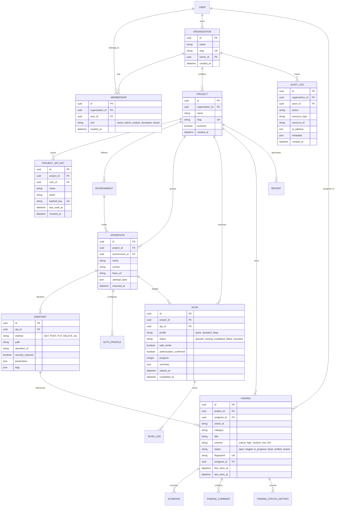
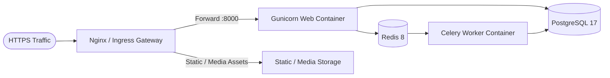

# API Sentinel — Developer-First API Security SaaS Platform

[](LICENSE)
[](https://nextjs.org/)
[](https://react.js.org/)
[](https://www.djangoproject.com/)
[](https://www.django-rest-framework.org/)
[](https://www.postgresql.org/)
[](https://redis.io/)
[](https://docs.celeryq.dev/)
[](https://tailwindcss.com/)

> **API Sentinel** is an enterprise-grade, multi-tenant API security management and vulnerability assessment platform. Engineered specifically for **authorized security testing**, it bridges the gap between software engineering, DevSecOps, and application security teams. It transforms raw OpenAPI specifications and API environments into comprehensive endpoint inventories, runs safe, non-destructive security evaluations aligned with the **OWASP API Security Top 10**, delivers actionable evidence and remediation guidance, and tracks findings through a complete collaborative triage lifecycle.

---

## Table of Contents

1. [Executive Summary](#1-executive-summary)
2. [Project Overview & Value Proposition](#2-project-overview--value-proposition)
3. [Key Capabilities & Feature Breakdown](#3-key-capabilities--feature-breakdown)
4. [Technology Stack](#4-technology-stack)
5. [System Architecture & Design](#5-system-architecture--design)
6. [Project Directory Structure](#6-project-directory-structure)
7. [Prerequisites & Installation](#7-prerequisites--installation)
   - [Option A: Docker Compose (Full Stack)](#option-a-docker-compose-full-stack-recommended)
   - [Option B: Local Manual Setup (Zero-Docker / SQLite)](#option-b-local-manual-setup-zero-docker--sqlite)
   - [Option C: Frontend Demo Mode (Zero Backend)](#option-c-frontend-demo-mode-zero-backend)
8. [Environment Variables & Configuration](#8-environment-variables--configuration)
9. [End-to-End Application Workflows](#9-end-to-end-application-workflows)
10. [User Roles & Permissions (RBAC Matrix)](#10-user-roles--permissions-rbac-matrix)
11. [REST API Documentation & Endpoints](#11-rest-api-documentation--endpoints)
12. [Database Architecture & Entity Relationships](#12-database-architecture--entity-relationships)
13. [Core Business Logic & Scanning Engine](#13-core-business-logic--scanning-engine)
14. [Development Commands & CLI Reference](#14-development-commands--cli-reference)
15. [Testing & Quality Assurance](#15-testing--quality-assurance)
16. [Security, Safety Model & Privacy](#16-security-safety-model--privacy)
17. [External Integrations & Services](#17-external-integrations--services)
18. [Production Deployment Guide](#18-production-deployment-guide)
19. [Troubleshooting & Frequently Asked Questions](#19-troubleshooting--frequently-asked-questions)
20. [Limitations & Product Roadmap](#20-limitations--product-roadmap)
21. [Contributing Guidelines](#21-contributing-guidelines)
22. [License & Acknowledgements](#22-license--acknowledgements)

---

## 1. Executive Summary

| Attribute | Details |
|---|---|
| **Platform Name** | **API Sentinel** |
| **System Category** | API Security SaaS / DAST & Specification Assessment Platform |
| **Primary Target** | Security Engineers, AppSec Leads, Backend Developers, DevOps/Platform Teams |
| **Architectural Model** | Multi-Tenant Decoupled Architecture (Next.js SPA/SSR + Django REST API + Celery Worker) |
| **Authentication** | Dual Authentication: PyJWT (Access + Refresh) & SHA-256 Hashed API Keys (`aps_...`) |
| **Scan Safety Guarantee** | **Strict Non-Destructive**. Requires explicit authorization confirmation; executes anti-SSRF IP boundary validation and zero-exploit low-impact checks |
| **Compliance Alignment** | OWASP API Security Top 10 (2023) |
| **Execution Flexibility** | Cloud-native Docker Compose or 100% offline local SQLite + synchronous Celery mode |
| **Frontend Flexibility** | Instant Interactive Demo Mode (`NEXT_PUBLIC_DEMO_MODE=true`) or Live Backend Mode |

---

## 2. Project Overview & Value Proposition

### 2.1 The Problem
Modern web architectures, microservices, and mobile applications rely heavily on APIs. However, rapid release cycles frequently result in:
- **Zombie and Shadow APIs**: Unmonitored, undocumented endpoints deployed without security reviews.
- **Flawed Access Controls**: Broken Object Level Authorization (BOLA) and Broken Object Property Level Authorization (BOPLA) exposing sensitive records.
- **Dangerous Outbound Interactions**: Unvalidated callback parameters and webhooks creating Server-Side Request Forgery (SSRF) vulnerabilities.
- **Aggressive & Destructive Scanners**: Traditional dynamic application security testing (DAST) tools often inject destructive SQL, drop database records, or trigger high-volume denial-of-service conditions in staging environments.

### 2.2 The Solution: API Sentinel
API Sentinel addresses these challenges by introducing a **developer-friendly, authorization-aware security platform**:
1. **Continuous Inventory Discovery**: Directly ingests OpenAPI 3.0/Swagger specifications to build an authoritative catalog of endpoints, HTTP methods, authentication boundaries, and query/body parameters.
2. **Safe, Specification-Driven Scanning**: Assesses endpoints using non-destructive inspection of schema contracts, missing authentication decorators, sensitive property disclosures, and low-impact connectivity checks.
3. **Structured Remediation Lifecycle**: Converts scanner outputs into persistent, deduplicated security findings with clear risk descriptions, impact explanations, actionable remediation steps, and verification commands.
4. **Team Collaboration & Audit Readiness**: Provides role-based access control (RBAC), finding assignment, status history transitions, collaborative discussion threads, downloadable executive reports, and immutable audit logging.

---

## 3. Key Capabilities & Feature Breakdown

### 3.1 Organization & Project Multi-Tenancy
- **Workspace Isolation**: Multi-tenant organizations manage multiple projects with strict logical data separation.
- **Environment Management**: Segment APIs across `Development`, `Staging`, `Production`, or custom runtime environments with dedicated base URLs.
- **Granular API Inventory**: Group services into distinct APIs with versioning (`v1`, `v2`, etc.), imported metadata, and endpoint counts.

### 3.2 OpenAPI Specification Import & Cataloging
- **Automated Schema Ingestion**: Parses OpenAPI 3.x specifications via JSON payload.
- **Endpoint Extraction**: Automatically catalogs HTTP methods (`GET`, `POST`, `PUT`, `PATCH`, `DELETE`, `HEAD`, `OPTIONS`), URI paths, operation IDs, parameter schemas, tags, and summary documentation.
- **Security Declaration Tracking**: Identifies whether operations declare active security schemes (e.g., Bearer auth, API keys, OAuth2) or are exposed anonymously.

### 3.3 Safe-Mode Vulnerability Scanner
- **Explicit Authorization Guardrail**: Scan execution is rejected unless the operator explicitly signs off on `authorization_confirmed=True`.
- **SSRF & Network Boundary Protection**: Target hostnames are resolved via DNS; all private, loopback, link-local, multicast, or non-routable addresses are automatically blocked (unless running in explicit `DEBUG` mode targeting localhost).
- **Scan Profiles**:
  - `Quick`: Rapid verification of baseline headers, inventory state, and critical authentication declarations.
  - `Standard`: Comprehensive evaluation across all cataloged endpoints and static schema checks.
  - `Deep`: Exhaustive multi-point analysis including response banner inspection and field-level parameter audits.
- **Asynchronous Execution**: Powered by Celery and Redis with real-time progress percentage tracking (0% → 100%) and structured event logs.

### 3.4 OWASP API Top 10 Aligned Rules
The included scanning engine currently implements five verified, high-impact rule sets:
- **`API2-AUTHENTICATION` (Broken Authentication)**: Detects endpoints missing documented security requirements (excluding standard `/health` and `/status` endpoints).
- **`API3-PROPERTY_AUTHORIZATION` (Broken Object Property Level Authorization)**: Identifies sensitive property parameters (e.g., `password`, `token`, `secret`, `api_key`, `ssn`, `card_number`) requiring strict role-based property allowlists.
- **`API7-SSRF` (Server-Side Request Forgery)**: Flags parameters accepting URL or callback values (`url`, `uri`, `callback`, `redirect`, `webhook`) that could trigger unauthorized server fetches.
- **`API8-MISCONFIGURATION` (Security Misconfiguration)**: Checks target responses for missing defensive HTTP headers (`X-Content-Type-Options`, `Content-Security-Policy`, `Referrer-Policy`) and information-leaking `Server` banners.
- **`API9-INVENTORY` (Improper Inventory Management)**: Flags API services operating without an active, synchronized OpenAPI specification.

### 3.5 Findings & Remediation Management
- **Intelligent Deduplication**: Uses SHA-256 fingerprinting (`project_id` + `check_id` + `endpoint_id` + `title`) to prevent duplicate finding clutter across re-scans.
- **Dynamic Security Scoring**: Calculates a health score from 0 to 100 based on weighted finding severities:
  $$\text{Score} = \max\left(0, 100 - (30 \times \text{Critical} + 15 \times \text{High} + 6 \times \text{Medium} + 2 \times \text{Low})\right)$$
- **Complete Finding Lifecycle**: Transitions across states: `Open` → `Triaged` → `In Progress` → `Fixed` → `Verified` → `Closed` / `False Positive`.
- **Audit History**: Every state change records the preceding status, successor status, acting user, and timestamp.
- **Evidence Vault**: Captures sanitized request and response data associated with each vulnerability.
- **Collaboration**: In-line team comments and role-governed user assignment.

### 3.6 Reporting & Compliance Artifacts
- **Dual Format Generation**:
  - **JSON**: Machine-readable structure suited for CI/CD ingestion, SIEM tools, and programmatic archiving.
  - **HTML**: Standalone, dark-themed, print-ready document containing project metadata, executive scorecards, severity counts, and finding tables.
- **Scoped Generation**: Filter report content by specific finding statuses.

### 3.7 Enterprise Audit Logging
- **Immutable Log Stream**: Records significant system activities (`ACCOUNT_REGISTERED`, `PROJECT_CREATED`, `PROJECT_API_KEY_CREATED`, `SCAN_CREATED`, `FINDING_UPDATED`, `FINDING_ASSIGNED`).
- **Comprehensive Context**: Logs capture the actor, organization, project, resource type, resource ID, action timestamp, client IP address (with reverse-proxy `X-Forwarded-For` parsing), and contextual metadata.

### 3.8 Programmatic Access & CI/CD Keys
- **Hashed Project API Keys**: Generate scoped API keys formatted as `aps_<random_token>`.
- **Secure Key Storage**: The database stores only the SHA-256 hash and a 10-character identification prefix (`aps_...`). Full raw keys are returned only once upon creation.
- **Revocation & Tracking**: Instant key invalidation with timestamped `last_used_at` telemetry.

### 3.9 Dual-Mode Frontend Console
- **Next.js App Router Architecture**: Built with React 19, TypeScript, and modern Tailwind CSS v4 styling.
- **Zero-Backend Demo Mode**: When `NEXT_PUBLIC_DEMO_MODE=true`, the UI operates independently using realistic mock data (`Sentinel Labs`, `Customer Platform`, `Mobile API`), ideal for demonstrations, UI development, and offline reviews.
- **Live Mode**: When `NEXT_PUBLIC_DEMO_MODE=false`, connects directly to the Django REST Framework API with full JWT session management.

---

## 4. Technology Stack

### 4.1 Backend Engine
| Technology | Version / Spec | Project Role | Justification |
|---|---|---|---|
| **Python** | `3.12+` | Core Runtime | High stability, native IP address handling, robust security libraries. |
| **Django** | `5.2 LTS` | Application Framework | Robust ORM, enterprise security defaults, administrative tooling. |
| **Django REST Framework** | `3.15+` | RESTful API Engine | Serializers, content negotiation, permission classes, viewsets. |
| **drf-spectacular** | `0.27+` | OpenAPI 3.0 Documentation | Auto-generates standard OpenAPI schemas and interactive Swagger UI. |
| **PyJWT** | `2.8+` | Authentication Tokens | Lightweight, secure issuance and verification of HS256 access and refresh JWTs. |
| **Celery** | `5.3+` | Distributed Task Queue | Offloads asynchronous network scans without blocking API worker threads. |
| **Redis** | `8-alpine` | Task Broker & Result Store | In-memory message transport for Celery scan jobs. |
| **Requests** | `2.31+` | HTTP Verification Client | Executes low-impact, timeout-constrained verification requests to targets. |
| **psycopg (psycopg 3)** | `3.1+ (binary)` | PostgreSQL Driver | Modern Python-PostgreSQL adapter supporting prepared statements and pooling. |
| **django-cors-headers** | `4.3+` | Cross-Origin Control | Enforces strict CORS headers for Next.js frontend communication. |
| **Gunicorn** | `22.0+` | WSGI Production Server | Multi-worker HTTP server for production deployment behind reverse proxies. |

### 4.2 Frontend Architecture
| Technology | Version / Spec | Project Role | Justification |
|---|---|---|---|
| **Next.js** | `16.3.3 (App Router)` | Frontend Framework | Hybrid SSR/client architecture, nested layouts, optimal asset bundling. |
| **React** | `19.2.0` | UI Library | Concurrent rendering, modern hooks, modular component trees. |
| **TypeScript** | `5.9+` | Type Safety | End-to-end interface contracts matching backend models and API responses. |
| **Tailwind CSS** | `4.3+ (@tailwindcss/postcss)`| Styling & Design System | High-performance CSS engine powering dark security-console aesthetics. |
| **Zod** | `4.1+` | Client-Side Validation | Schema definition and input validation for frontend forms. |

### 4.3 Database & Infrastructure
| Technology | Version / Spec | Role |
|---|---|---|
| **PostgreSQL** | `17-alpine` | Primary Relational Database (Docker / Production). |
| **SQLite 3** | `Built-in` | Zero-configuration local database fallback for development (`USE_SQLITE=1`). |
| **Docker & Compose** | `Compose v2` | Multi-container orchestration (`web`, `worker`, `db`, `redis`). |

---

## 5. System Architecture & Design

### 5.1 High-Level Architecture Diagram
The following Mermaid diagram illustrates the interaction between the Next.js client, Django REST API, database, Celery workers, and external target APIs:

```mermaid
graph TB
    subgraph ClientLayer ["Client & Interface Layer"]
        Browser["Next.js Web Client<br/>(React 19 / TypeScript / Tailwind CSS)"]
        CLI["CI/CD Runner / External Tool<br/>(Project API Key: aps_...)"]
    end

    subgraph EdgeLayer ["Gateway & Edge"]
        Nginx["Reverse Proxy / Nginx<br/>(Port 80/443, SSL, CORS)"]
    end

    subgraph BackendApp ["API Sentinel Backend (Django 5.2)"]
        API_GW["DRF API Router<br/>(/api/v1/...)"]
        AuthModule["Auth & RBAC Middleware<br/>(JWT & API-Key Auth)"]
        AuditService["Audit Trail Service<br/>(IP, Action, Resource)"]
        ReportGen["Report Generator<br/>(JSON & HTML Engine)"]
        SpecParser["OpenAPI 3.0 Parser<br/>(apis.services.import_openapi)"]
    end

    subgraph WorkerLayer ["Async Execution Layer"]
        RedisQueue["Redis Broker & State Store<br/>(Port 6379)"]
        CeleryWorker["Celery Scan Worker<br/>(scans.tasks.execute_scan)"]
        ScanEngine["Safe Scan Engine<br/>(scans.engine.run_scan)"]
        NetworkPolicy["Target IP Validator<br/>(Anti-SSRF Protection)"]
    end

    subgraph PersistenceLayer ["Data Storage"]
        PostgresDB[(PostgreSQL 17 / SQLite 3<br/>Multi-Tenant DB)]
    end

    subgraph TargetEstate ["Authorized Target API Estate"]
        TargetAPI["Customer API Target<br/>(GET / Base URL Connectivity)"]
    end

    Browser -->|HTTP/REST / JWT Bearer| Nginx
    CLI -->|HTTP/REST / Api-Key Header| Nginx
    Nginx --> API_GW

    API_GW --> AuthModule
    AuthModule --> SpecParser
    AuthModule --> ReportGen
    AuthModule --> AuditService
    AuditService --> PostgresDB

    API_GW -->|Enqueue Scan Job| RedisQueue
    RedisQueue --> CeleryWorker
    CeleryWorker --> ScanEngine

    ScanEngine --> NetworkPolicy
    NetworkPolicy -->|Resolve DNS & Validate IP| NetworkPolicy
    NetworkPolicy -->|Safe GET Request (No Exploit)| TargetAPI
    ScanEngine -->|Write Findings & Logs| PostgresDB

    SpecParser -->|Persist Endpoints| PostgresDB
    ReportGen -->|Read Findings| PostgresDB
```

### 5.2 Scan & Security Evaluation Lifecycle Flow

```mermaid
sequenceDiagram
    autonumber
    actor User as Security Analyst / Developer
    participant UI as Next.js Console
    participant API as Django REST API (/api/v1/scans/run/)
    participant DB as PostgreSQL Database
    participant Celery as Celery Worker
    participant Engine as Scan Engine
    participant Target as Target API Service

    User->>UI: Select API & Click "Run Scan"
    Note over User,UI: Explicit consent required: authorization_confirmed = True
    UI->>API: POST /api/v1/scans/run/ { api_id, profile, authorization_confirmed: true }
    API->>DB: Verify Org Membership & Create Scan (Status: QUEUED)
    API->>DB: Log Audit Event: SCAN_CREATED
    API->>Celery: execute_scan.delay(scan_id)
    API-->>UI: 202 Accepted { id, status: "queued", progress: 0 }

    activate Celery
    Celery->>Engine: run_scan(scan_id)
    Engine->>DB: Update Scan Status -> RUNNING (Progress: 5%)
    
    rect rgb(20, 30, 45)
        Note over Engine,DB: Static OpenAPI Inspection
        Engine->>DB: Fetch All Registered Endpoints
        loop For Each Endpoint
            Engine->>Engine: Check Missing Security Requirement (API2)
            Engine->>Engine: Check Callback/URL Parameters (API7 SSRF)
            Engine->>Engine: Check Sensitive Property Names (API3 BOPLA)
            opt Violation Found
                Engine->>DB: Insert Finding with Fingerprint & Evidence
            end
        end
    end

    rect rgb(25, 40, 30)
        Note over Engine,Target: Network Safety & Target Connectivity
        Engine->>Engine: Validate Target Host (Reject Private/Loopback IPs)
        alt Target Passes Validation
            Engine->>Target: GET / (Timeout: 5s, User-Agent: API-Sentinel/0.1)
            Target-->>Engine: HTTP Response Headers
            Engine->>Engine: Evaluate Missing Headers (CSP, Referrer, No-Sniff)
            Engine->>Engine: Check Server Header Info Disclosure
            opt Misconfiguration Found
                Engine->>DB: Record API8 Finding
            end
        else Target IP is Private / Blocked
            Engine->>DB: Write Scan Log Warning (Blocked by Policy)
        end
    end

    Engine->>Engine: Calculate Security Score (100 - Severity Penalties)
    Engine->>DB: Update Scan -> COMPLETED (Progress: 100%, Summary, Score)
    deactivate Celery

    UI->>API: Poll GET /api/v1/scans/{id}/
    API-->>UI: Return 200 OK { status: "completed", progress: 100, summary }
    UI-->>User: Display Security Scorecard & Findings List
```



---

## 6. Project Directory Structure

```text
API Sentinel/
├── README.md                                  # Root comprehensive documentation
├── api-sentinel-backend/                      # Django REST Framework Backend
│   ├── manage.py                              # Django CLI management executable
│   ├── Dockerfile                             # Container image definition for web/worker
│   ├── docker-compose.yml                     # Multi-service container orchestration
│   ├── requirements.txt                       # Python package dependencies
│   ├── .env.example                           # Backend environment template
│   ├── .env                                   # Active backend environment file
│   ├── config/                                # Core Django project configuration
│   │   ├── __init__.py                        # Celery app export
│   │   ├── asgi.py                            # ASGI entrypoint
│   │   ├── celery.py                          # Celery application initialization
│   │   ├── settings.py                        # Unified Django settings (SQLite/PG, JWT, Celery)
│   │   ├── urls.py                            # Root URL routing & Swagger endpoints
│   │   └── wsgi.py                            # WSGI entrypoint for Gunicorn
│   ├── accounts/                              # Authentication & User Management
│   │   ├── authentication.py                  # Custom JWT & Project API Key authenticators
│   │   ├── serializers.py                     # Register, Login, Refresh, User serializers
│   │   ├── tokens.py                          # HS256 JWT encoding, decoding, validation
│   │   ├── urls.py                            # /api/v1/auth/ routes
│   │   └── views.py                           # Register, Login, Refresh, Me views
│   ├── organizations/                         # Multi-Tenant Organizations & RBAC
│   │   ├── models.py                          # Organization & Membership models
│   │   ├── permissions.py                     # IsOrgMember, HasOrgWritePermission, HasOrgAdminPermission
│   │   ├── urls.py                            # /api/v1/organizations/ routes
│   │   ├── views.py                           # Organization & membership management views
│   │   └── management/commands/               # Django management commands
│   │       └── seed_demo.py                   # Automated workspace and demo spec seeder
│   ├── projects/                              # Projects & Programmatic API Keys
│   │   ├── models.py                          # Project & ProjectAPIKey (aps_...) models
│   │   ├── serializers.py                     # Project & API Key serializers
│   │   ├── urls.py                            # /api/v1/projects/ routes
│   │   └── views.py                           # Project CRUD & API Key generation/revocation
│   ├── apis/                                  # API Estate, Environments & OpenAPI Parser
│   │   ├── models.py                          # Environment, APIService, Endpoint, AuthProfile models
│   │   ├── services.py                        # import_openapi() specification parser
│   │   ├── urls.py                            # /api/v1/apis/ and endpoint routes
│   │   └── views.py                           # Environment/API/Endpoint views & OpenAPI import
│   ├── scans/                                 # Scan Jobs & Vulnerability Engine
│   │   ├── engine.py                          # run_scan() core vulnerability evaluation logic
│   │   ├── models.py                          # Scan and ScanLog models
│   │   ├── network_policy.py                  # validate_target_url() anti-SSRF IP boundary validator
│   │   ├── tasks.py                           # execute_scan Celery task wrapper
│   │   ├── urls.py                            # /api/v1/scans/ routes
│   │   └── views.py                           # Scan execution, status polling, and log views
│   ├── findings/                              # Findings, Evidence & Remediation
│   │   ├── models.py                          # Finding, Evidence, Comment, StatusHistory models
│   │   ├── serializers.py                     # Finding and comment serialization
│   │   ├── urls.py                            # /api/v1/findings/ routes
│   │   └── views.py                           # Finding triage, assignment, comments, updates
│   ├── reports/                               # Security Report Generation
│   │   ├── models.py                          # Report model (JSON & HTML formats)
│   │   ├── services.py                        # build_content() and render_html() report generators
│   │   ├── urls.py                            # /api/v1/reports/ routes
│   │   └── views.py                           # Report generation, listing, and download views
│   ├── audit/                                 # Enterprise Audit Logging
│   │   ├── models.py                          # AuditLog model
│   │   ├── services.py                        # audit() event dispatch utility
│   │   ├── urls.py                            # /api/v1/audit-logs/ routes
│   │   └── views.py                           # Audit log querying view
│   └── tests/                                 # Backend Test Suite
│       └── test_smoke.py                      # Health and import verification tests
│
└── api-sentinel-frontend/                     # Next.js 16 App Router Frontend
    ├── package.json                           # Node dependencies & npm run scripts
    ├── tsconfig.json                          # TypeScript configuration
    ├── next.config.ts                         # Next.js configuration
    ├── postcss.config.mjs                     # PostCSS config with Tailwind v4 plugin
    ├── .env.example                           # Frontend environment template
    ├── .env.local                             # Local runtime frontend configuration
    ├── app/                                   # Next.js App Router Structure
    │   ├── layout.tsx                         # Root HTML layout and provider injection
    │   ├── page.tsx                           # High-converting marketing & product landing page
    │   ├── globals.css                        # Design tokens, cyber dark theme, grid backgrounds
    │   ├── (public)/                          # Public information routes
    │   │   ├── features/page.tsx              # Deep-dive platform capabilities page
    │   │   ├── pricing/page.tsx               # Transparent tier pricing page
    │   │   ├── security/page.tsx              # Security model & authorized testing manifesto
    │   │   ├── contact/page.tsx               # Contact & enterprise inquiry page
    │   │   ├── docs/page.tsx                  # In-app quick start documentation
    │   │   ├── login/page.tsx                 # User authentication sign-in page
    │   │   └── register/page.tsx              # Workspace creation with consent sign-off
    │   └── app/                               # Authenticated Security Console (/app)
    │       ├── layout.tsx                     # Protected shell layout
    │       ├── page.tsx                       # Main Overview: Scorecard, finding bars, quick actions
    │       ├── projects/                      # Project catalog & project detail views
    │       ├── apis/                          # API services & OpenAPI import screens
    │       ├── endpoints/                     # Deep-dive endpoint contract inspection
    │       ├── scans/                         # Scan launch form, progress monitor, and scan logs
    │       ├── findings/                      # Finding triage board, evidence, comments, assignment
    │       ├── reports/                       # Report builder, format selector, and downloads
    │       ├── team/                          # Organization member list and role administration
    │       ├── audit-log/                     # Filterable activity stream
    │       └── settings/                      # Workspace preferences & API key management
    ├── components/                            # Reusable UI Component Library
    │   ├── app-shell.tsx                      # Primary navigation sidebar, header, and user profile
    │   ├── auth-provider.tsx                  # React Context handling tokens and current session
    │   ├── providers.tsx                      # Root component provider wrapper
    │   ├── ui.tsx                             # Design system: Button, Card, Badge, Modal, Input, Table
    │   └── icons.tsx                          # Optimized SVG iconography set
    └── lib/                                   # Data Layer & Client Utilities
        ├── types.ts                           # Full TypeScript interfaces for all domain models
        ├── api.ts                             # Typed Fetch client with JWT interceptor & error wrapper
        └── demo.ts                            # Comprehensive mock data repository for Demo Mode
```

---

## 7. Prerequisites & Installation

### Option A: Docker Compose (Full Stack — Recommended)
This launches PostgreSQL 17, Redis 8, the Django REST backend, and the Celery scan worker in containerized isolation.

#### 1. Prerequisites
- [Docker Desktop](https://www.docker.com/products/docker-desktop/) (v24.0+ recommended)
- [Node.js](https://nodejs.org/) (v20.x or v22.x LTS) and `npm`

#### 2. Start the Backend Infrastructure
```bash
# 1. Navigate to the backend directory
cd api-sentinel-backend

# 2. Configure the backend environment
cp .env.example .env

# Edit .env to set USE_SQLITE=0 to use PostgreSQL container:
# USE_SQLITE=0
# CELERY_TASK_ALWAYS_EAGER=0

# 3. Launch the container cluster
docker compose up --build -d
```

Verify running services:
```bash
docker compose ps
```
The cluster exposes:
- **Django REST API**: `http://localhost:8000`
- **Swagger Documentation**: `http://localhost:8000/api/docs/`
- **PostgreSQL**: `localhost:5432`
- **Redis**: `localhost:6379`

#### 3. Seed Demo Data & Superuser
```bash
# Populate the database with a pre-configured organization, project, and OpenAPI inventory
docker compose exec web python manage.py seed_demo

# (Optional) Create a superuser for the Django Admin interface
docker compose exec web python manage.py createsuperuser
```

#### 4. Launch the Next.js Frontend
```bash
# Open a new terminal and navigate to the frontend directory
cd api-sentinel-frontend

# Install dependencies
npm install

# Configure environment for live backend communication
cat << 'EOF' > .env.local
NEXT_PUBLIC_API_URL=http://localhost:8000/api/v1
NEXT_PUBLIC_DEMO_MODE=false
EOF

# Start the Next.js development server
npm run dev
```
Open **`http://localhost:3000`** in your browser. You can sign in using:
- **Email**: `demo@api-sentinel.local`
- **Password**: `ChangeMe123!`

---

### Option B: Local Manual Setup (Zero-Docker / SQLite)
You can run API Sentinel locally without Docker or Redis by leveraging the built-in SQLite engine and Celery synchronous mode.

#### 1. Backend Setup
```bash
cd api-sentinel-backend

# Create and activate a Python virtual environment
python -m venv .venv

# On Windows (PowerShell):
.venv\Scripts\Activate.ps1
# On macOS / Linux:
# source .venv/bin/activate

# Install dependencies
pip install -r requirements.txt

# Configure environment for SQLite + synchronous execution
cp .env.example .env
# Confirm the following defaults in .env:
# USE_SQLITE=1
# CELERY_TASK_ALWAYS_EAGER=1

# Run database migrations
python manage.py migrate

# Seed sample workspace and OpenAPI endpoints
python manage.py seed_demo

# Start the Django development server
python manage.py runserver 8000
```

#### 2. Frontend Setup
```bash
cd api-sentinel-frontend
npm install

cat << 'EOF' > .env.local
NEXT_PUBLIC_API_URL=http://localhost:8000/api/v1
NEXT_PUBLIC_DEMO_MODE=false
EOF

npm run dev
```

---

### Option C: Frontend Demo Mode (Zero Backend)
If you want to evaluate the UI, explore features, or present a demonstration without running any Python environment or database:

```bash
cd api-sentinel-frontend
npm install

# Set demo mode to true
cat << 'EOF' > .env.local
NEXT_PUBLIC_API_URL=http://localhost:8000/api/v1
NEXT_PUBLIC_DEMO_MODE=true
EOF

npm run dev
```
Navigate to **`http://localhost:3000`**. The entire application operates instantly using rich mock data with simulated findings, scorecards, scans, and audit trails.

---

## 8. Environment Variables & Configuration

### 8.1 Backend Variables (`api-sentinel-backend/.env`)

| Variable | Purpose | Required? | Default / Example Value |
|---|---|---|---|
| `DEBUG` | Enables Django debug mode and allows localhost scan targets | **Required** | `1` (Development), `0` (Production) |
| `SECRET_KEY` | Cryptographic secret for Django sessions and token signing | **Required** | `change-me-in-production` (Must change in prod) |
| `ALLOWED_HOSTS` | Comma-delimited valid HTTP Host headers | **Required** | `localhost,127.0.0.1` |
| `CORS_ALLOWED_ORIGINS` | Permitted cross-origin browser origins | **Required** | `http://localhost:3000` |
| `USE_SQLITE` | Flag to use local SQLite instead of PostgreSQL | Optional | `1` (SQLite), `0` (PostgreSQL) |
| `CELERY_TASK_ALWAYS_EAGER` | Runs Celery jobs synchronously in-process (no Redis needed) | Optional | `1` (When using SQLite), `0` (When using Redis) |
| `POSTGRES_DB` | PostgreSQL database name | Required if `USE_SQLITE=0` | `api_sentinel` |
| `POSTGRES_USER` | PostgreSQL user account | Required if `USE_SQLITE=0` | `postgres` |
| `POSTGRES_PASSWORD` | PostgreSQL user password | Required if `USE_SQLITE=0` | `postgres` |
| `POSTGRES_HOST` | PostgreSQL hostname or container service name | Required if `USE_SQLITE=0` | `db` (Docker) or `localhost` |
| `POSTGRES_PORT` | PostgreSQL database port | Required if `USE_SQLITE=0` | `5432` |
| `REDIS_URL` | Redis broker and backend connection URL | Required if eager is `0` | `redis://redis:6379/0` (Docker) or `redis://localhost:6379/0` |
| `JWT_ACCESS_MINUTES` | Access token lifespan in minutes | Optional | `30` |
| `JWT_REFRESH_DAYS` | Refresh token lifespan in days | Optional | `7` |
| `SECURE_SSL_REDIRECT` | Enforces HTTPS redirects | Optional | `0` (Dev), `1` (Prod behind HTTPS) |

### 8.2 Frontend Variables (`api-sentinel-frontend/.env.local`)

| Variable | Purpose | Required? | Default / Example Value |
|---|---|---|---|
| `NEXT_PUBLIC_API_URL` | Base URL for backend REST API endpoints | **Required** | `http://localhost:8000/api/v1` |
| `NEXT_PUBLIC_DEMO_MODE` | Toggles standalone mock data vs live backend communication | **Required** | `false` (Live mode), `true` (Standalone demo) |

---

## 9. End-to-End Application Workflows

Follow this step-by-step journey to understand how API Sentinel operates from onboarding to vulnerability verification:

```
[Register Account] ➔ [Workspace Provisioning] ➔ [Project Creation] ➔ [Import OpenAPI] 
         ➔ [Authorized Scan] ➔ [Investigate Findings] ➔ [Remediate & Rescan] ➔ [Export Report]
```

### Step 1: User Onboarding & Authorization Sign-off
1. Navigate to `/register`.
2. Fill in your name, email, strong password (minimum 10 characters), and organization name.
3. Check the mandatory **Authorized Testing Acknowledgement** (`authorized_testing_acknowledgement=True`).
4. Upon submission, an `Organization` is created with your account set as `Owner`. An initial JWT token pair is generated and saved to browser storage.

### Step 2: Establish Project & Environment
1. In the console sidebar, open **Projects** (`/app/projects`).
2. Click **Create Project**, entering a name (e.g., `Customer Portal API`) and description.
3. Define the deployment **Environment** (e.g., `Staging`, `Production`) and provide the API service base URL (e.g., `https://api.example.com`).

### Step 3: Ingest OpenAPI Specification
1. Navigate to **APIs** (`/app/apis`) and select your API service.
2. Select **Import OpenAPI Specification** and paste your OpenAPI 3.x JSON document.
3. The backend executes `apis.services.import_openapi`:
   - Extracts version, servers, and operation metadata.
   - Populates the database with individual `Endpoint` records.
   - Automatically determines if endpoints enforce security declarations.

### Step 4: Execute an Authorized Security Scan
1. Navigate to **Scans** (`/app/scans`) and click **Run New Scan**.
2. Select your target API and choose a profile (`Quick`, `Standard`, or `Deep`).
3. Explicitly verify the authorization confirmation toggle.
4. Click **Start Scan**:
   - The job is dispatched to Celery (`scans.tasks.execute_scan`).
   - The progress bar dynamically advances as endpoints are evaluated.
   - Scan logs capture step-by-step telemetry in real time.

### Step 5: Triage Findings & Evidence
1. Navigate to **Findings** (`/app/findings`).
2. Review vulnerabilities categorized by severity (`Critical`, `High`, `Medium`, `Low`).
3. Click any finding to inspect:
   - **Risk Description & Impact Summary**.
   - **Sanitized Evidence** (request and response records).
   - **Remediation Guidelines & Verification Steps**.
4. Update the finding status from `Open` to `Triaged` or `In Progress`.
5. Assign the finding to an organization team member.

### Step 6: Generate Executive & Compliance Reports
1. Navigate to **Reports** (`/app/reports`) and click **Generate Report**.
2. Select the report scope (all findings or filtered by status) and format (`HTML` or `JSON`).
3. Click **Download**:
   - The standalone HTML report renders a styled executive scorecard, severity distribution breakdown, and detailed vulnerability table suitable for external stakeholder review.

---

## 10. User Roles & Permissions (RBAC Matrix)

API Sentinel enforces multi-tenant Role-Based Access Control (RBAC) via the `organizations.models.Membership` model. Every user belongs to an organization with one of five distinct roles:

1. **Owner (`owner`)**: Full authority over organization billing, deletion, projects, API keys, scans, and user administration.
2. **Admin (`admin`)**: Manages projects, members, API keys, environments, scans, and findings. Cannot delete the organization.
3. **Security Analyst (`analyst`)**: Executes scans, reviews evidence, updates finding statuses, creates comments, and exports reports. Cannot delete projects or revoke administrative API keys.
4. **Developer (`developer`)**: Manages API inventories, environments, imports specs, updates finding statuses, and reads evidence. Cannot revoke other members' API keys.
5. **Viewer (`viewer`)**: Read-only access to dashboards, endpoints, scan logs, and reports. Cannot execute scans, modify findings, or invite members.

### Permissions Enforcement Matrix

| Feature / Action | Owner | Admin | Security Analyst | Developer | Viewer | Codebase Enforcement |
|---|:---:|:---:|:---:|:---:|:---:|---|
| **View Dashboards & Inventory** | ✅ | ✅ | ✅ | ✅ | ✅ | `IsOrgMember` |
| **Create Projects & APIs** | ✅ | ✅ | ❌ | ✅ | ❌ | `HasOrgWritePermission` / Role check |
| **Import OpenAPI Specs** | ✅ | ✅ | ✅ | ✅ | ❌ | `HasOrgWritePermission` |
| **Generate Project API Keys** | ✅ | ✅ | ❌ | ✅ | ❌ | `ProjectAPIKey.generate()` check |
| **Revoke Project API Keys** | ✅ | ✅ | ❌ | ❌ | ❌ | `HasOrgAdminPermission` |
| **Trigger Security Scans** | ✅ | ✅ | ✅ | ✅ | ❌ | `IsOrgMember` + write check |
| **Update Finding Status** | ✅ | ✅ | ✅ | ✅ | ❌ | `FindingDetailView` update check |
| **Assign Findings to Users** | ✅ | ✅ | ✅ | ✅ | ❌ | `FindingAssignView` (Excludes `viewer`) |
| **Add Finding Comments** | ✅ | ✅ | ✅ | ✅ | ❌ | `FindingCommentListCreateView` |
| **Generate & Export Reports** | ✅ | ✅ | ✅ | ✅ | ✅ | `IsOrgMember` |
| **Inspect Organization Audit Logs**| ✅ | ✅ | ✅ | ❌ | ❌ | `HasOrgAdminPermission` / Admin filter |
| **Manage Team Members** | ✅ | ✅ | ❌ | ❌ | ❌ | `OrganizationMembersView` |

---

## 11. REST API Documentation & Endpoints

All backend endpoints are prefixed with `/api/v1/` and return `application/json`. Detailed interactive documentation is available via **Swagger UI** at `http://localhost:8000/api/docs/`.

### 11.1 Authentication (`accounts`)

#### Register Account
- **`POST /api/v1/auth/register/`**
- **Auth**: None (`AllowAny`)
- **Body**:
  ```json
  {
    "email": "analyst@example.com",
    "password": "SecurePassword123!",
    "first_name": "Alex",
    "last_name": "Vance",
    "organization_name": "Vance Security Lab",
    "authorized_testing_acknowledgement": true
  }
  ```
- **Response `201 Created`**:
  ```json
  {
    "user": {
      "id": "e6f8b1c4-9271-419b-a320-a612503282b0",
      "email": "analyst@example.com",
      "first_name": "Alex",
      "last_name": "Vance"
    },
    "organization": {
      "id": "78e91f11-9f93-41bb-98a4-569d67568282",
      "name": "Vance Security Lab",
      "slug": "vance-security-lab"
    },
    "tokens": {
      "access": "eyJhbGciOiJIUzI1NiIsIn...",
      "refresh": "eyJhbGciOiJIUzI1NiIsIn..."
    }
  }
  ```

#### Login
- **`POST /api/v1/auth/login/`**
- **Auth**: None (`AllowAny`)
- **Body**: `{"email": "analyst@example.com", "password": "SecurePassword123!"}`
- **Response `200 OK`**: Returns user profile and token pair.

#### Refresh Access Token
- **`POST /api/v1/auth/refresh/`**
- **Auth**: None (`AllowAny`)
- **Body**: `{"refresh": "<refresh_token>"}`
- **Response `200 OK`**: `{"tokens": {"access": "...", "refresh": "..."}}`

#### Get Current Identity
- **`GET /api/v1/auth/me/`**
- **Auth**: `Bearer <access_token>`
- **Response `200 OK`**: Returns current authenticated user record.

---

### 11.2 Organizations & Projects (`organizations`, `projects`)

#### List / Create Organizations
- **`GET /api/v1/organizations/`**: Returns all organizations where user is a member.
- **`POST /api/v1/organizations/`**: Creates a new organization.

#### List / Create Projects
- **`GET /api/v1/projects/`**: Returns non-archived projects in the user's organization.
- **`POST /api/v1/projects/`**:
  ```json
  {
    "organization": "78e91f11-9f93-41bb-98a4-569d67568282",
    "name": "E-Commerce Gateway",
    "description": "Production checkout and product catalog APIs"
  }
  ```

#### Generate Programmatic Project API Key
- **`POST /api/v1/projects/{project_id}/api-keys/`**
- **Auth**: `Bearer <token>` (Owner, Admin, Developer)
- **Body**: `{"name": "GitHub Actions CI Scanner"}`
- **Response `201 Created`**:
  ```json
  {
    "id": "18cf85d9-4fa2-463e-a89c-519782559b92",
    "name": "GitHub Actions CI Scanner",
    "prefix": "aps_w9k1la",
    "key": "aps_w9k1la89df7sdf98sdf7sd89f7sdf89sdf"
  }
  ```
  *(Note: Store the `key` value immediately. Only the hash is retained).*

#### Revoke API Key
- **`POST /api/v1/api-keys/{id}/revoke/`**
- **Auth**: `Bearer <token>` (Owner or Admin)
- **Response `200 OK`**: `{"status": "revoked"}`

---

### 11.3 APIs & OpenAPI Import (`apis`)

#### Create Environment
- **`POST /api/v1/projects/{project_id}/environments/`**
- **Body**:
  ```json
  {
    "name": "Staging",
    "kind": "staging",
    "base_url": "https://staging-api.example.com"
  }
  ```

#### Create API Service
- **`POST /api/v1/projects/{project_id}/apis/`**
- **Body**:
  ```json
  {
    "environment": "<environment_id>",
    "name": "Customer Service",
    "base_url": "https://staging-api.example.com"
  }
  ```

#### Ingest OpenAPI Specification
- **`POST /api/v1/apis/{api_id}/openapi/import/`**
- **Body**: Raw OpenAPI 3.0 specification JSON object.
- **Response `200 OK`**:
  ```json
  {
    "imported_endpoints": 28,
    "version": "1.4.0",
    "base_url": "https://staging-api.example.com"
  }
  ```

#### List Endpoints
- **`GET /api/v1/apis/{api_id}/endpoints/`**
- **Response `200 OK`**: Returns cataloged endpoints with HTTP methods, paths, and security requirements.

---

### 11.4 Security Scans (`scans`)

#### Trigger Authorized Security Scan
- **`POST /api/v1/scans/run/`**
- **Auth**: `Bearer <token>` or `Api-Key aps_...`
- **Body**:
  ```json
  {
    "api_id": "8e31002c-4731-4876-b9a2-51bc4b5b6301",
    "profile": "standard",
    "safe_mode": true,
    "authorization_confirmed": true
  }
  ```
- **Response `202 Accepted`**:
  ```json
  {
    "id": "993a401c-602f-4882-965a-8bfe3f92b740",
    "status": "queued",
    "profile": "standard",
    "progress": 0,
    "created_at": "2026-10-10T14:30:00Z"
  }
  ```

#### Get Scan Status & Progress
- **`GET /api/v1/scans/{id}/`**
- **Response `200 OK`**:
  ```json
  {
    "id": "993a401c-602f-4882-965a-8bfe3f92b740",
    "status": "completed",
    "progress": 100,
    "summary": {
      "security_score": 88,
      "findings": {
        "critical": 0,
        "high": 0,
        "medium": 2,
        "low": 1
      },
      "endpoints_checked": 14
    },
    "started_at": "2026-10-10T14:30:01Z",
    "completed_at": "2026-10-10T14:30:08Z"
  }
  ```

#### Inspect Scan Event Logs
- **`GET /api/v1/scans/{id}/logs/`**
- **Response `200 OK`**: Chronological log stream detailing scan stages and checks performed.

---

### 11.5 Findings & Triage (`findings`)

#### List Findings
- **`GET /api/v1/findings/?project={project_id}&severity=high&status=open`**
- Supports filtering by `severity`, `status`, `category`, and `project`.

#### Update Finding Status
- **`PATCH /api/v1/findings/{id}/`**
- **Body**: `{"status": "in_progress"}`
- **Response `200 OK`**: Status transition recorded in `FindingStatusHistory`.

#### Assign Finding
- **`POST /api/v1/findings/{id}/assign/`**
- **Body**: `{"user_id": "<target_user_uuid>"}`

#### Add Finding Discussion Comment
- **`POST /api/v1/findings/{id}/comments/`**
- **Body**: `{"body": "Applied field allowlist in serializer commit 9fa2c1."}`

---

### 11.6 Reports & Auditing (`reports`, `audit`)

#### Generate Report
- **`POST /api/v1/reports/generate/`**
- **Body**:
  ```json
  {
    "project_id": "<project_id>",
    "name": "Q4 Security Assessment",
    "report_format": "html",
    "scope": {
      "finding_status": ["open", "triaged", "in_progress"]
    }
  }
  ```

#### Download Standalone Report
- **`GET /api/v1/reports/{id}/download/`**
- Returns standalone HTML (`text/html`) or structured JSON (`application/json`).

#### List Organization Audit Logs
- **`GET /api/v1/organizations/{organization_id}/audit-logs/`**
- Returns paginated audit events with IP addresses, acting users, and metadata.

---

## 12. Database Architecture & Entity Relationships

API Sentinel's relational schema enforces multi-tenant isolation, structured scan pipelines, and audit trails.



---

## 13. Core Business Logic & Scanning Engine

### 13.1 Non-Destructive Scanning Philosophy
Unlike traditional penetration testing tools that transmit exploit payloads or high-concurrency fuzzing patterns, API Sentinel is designed for **safe, authorized verification**:
1. **Contractual & Static Schema Verification**: Inspects the declared OpenAPI contract against OWASP API Security best practices.
2. **Read-Only Verification**: Connects only to base service URLs using low-impact `GET` requests with a 5-second timeout.
3. **No Auth Replay or Fuzzing**: Avoids injecting credential stuffing, database mutation payloads, or destructive actions.

### 13.2 SSRF Protection & Network Isolation (`scans/network_policy.py`)
To prevent attackers from using the scanner as a proxy to attack internal infrastructure or cloud metadata services (`169.254.169.254`), the target validation engine enforces strict controls:

```python
# Verified implementation logic in scans/network_policy.py:
ALLOWED_SCHEMES = {'http', 'https'}

def validate_target_url(url):
    parsed = urlparse(url)
    if parsed.scheme not in ALLOWED_SCHEMES or not parsed.hostname:
        raise ValueError('Target URL must use http/https and include a hostname.')
    
    # Allow localhost exclusively during local development
    if getattr(settings, 'DEBUG', False) and parsed.hostname in {'localhost', '127.0.0.1', '::1'}:
        return parsed
        
    infos = socket.getaddrinfo(parsed.hostname, ...)
    for raw in {info[4][0] for info in infos}:
        ip = ip_address(raw)
        if ip.is_private or ip.is_loopback or ip.is_link_local or ip.is_reserved or ip.is_multicast or ip.is_unspecified:
            raise ValueError('Target resolves to a non-public network address.')
    return parsed
```

### 13.3 Finding Deduplication Algorithm (`scans/engine.py`)
To avoid creating duplicate entries during repeated scans, the engine calculates a deterministic SHA-256 fingerprint:
$$\text{Fingerprint} = \text{SHA256}(\text{project\_id} : \text{check\_id} : \text{endpoint\_id} : \text{title})$$
When a finding matches an existing fingerprint, it updates `last_seen_at` without duplicating the record or overriding active triage assignments.

### 13.4 Security Score Formulation
The security health score is calculated dynamically based on total active findings:
```python
score = max(0, 100 - (critical * 30 + high * 15 + medium * 6 + low * 2))
```
- **100**: Clean security posture.
- **80–99**: Minor warnings or configuration adjustments recommended.
- **50–79**: Moderate risk requiring prompt remediation.
- **< 50**: High risk containing critical or multiple high-severity vulnerabilities.

---

## 14. Development Commands & CLI Reference

### 14.1 Backend Commands (from `api-sentinel-backend/`)
```bash
# Run migrations
python manage.py migrate

# Create new database migrations
python manage.py makemigrations

# Seed sample workspace and demo OpenAPI inventory
python manage.py seed_demo

# Create an administrative user
python manage.py createsuperuser

# Start development web server
python manage.py runserver 8000

# Start Celery worker (when using Redis)
celery -A config worker -l INFO

# Execute automated tests
python manage.py test tests
```

### 14.2 Frontend Commands (from `api-sentinel-frontend/`)
```bash
# Install node dependencies
npm install

# Start development server (http://localhost:3000)
npm run dev

# Run TypeScript type check without emitting files
npm run typecheck

# Build optimized production bundle
npm run build

# Start production server
npm run start
```

### 14.3 Docker Commands
```bash
# Build and start all backend services in the background
docker compose up --build -d

# View live service logs
docker compose logs -f web worker

# Stop container services
docker compose down

# Stop and wipe database/redis volumes (Full Reset)
docker compose down -v
```

---

## 15. Testing & Quality Assurance

### 15.1 Current Implementation State
- **Backend**:
  - `tests/test_smoke.py`: Contains sanity and health import checks verifying that Django configurations, models, and apps load cleanly.
  - Can be executed via `python manage.py test tests`.
- **Frontend**:
  - TypeScript strict mode enabled (`tsconfig.json`).
  - Strict type checking executable via `npm run typecheck` (`tsc --noEmit`).
  - Next.js production build verification executable via `npm run build`.

### 15.2 Recommended Testing Roadmap (Future Expansion)
To prepare for high-compliance production deployments, the following automated test expansions are recommended:
1. **Tenant Isolation Unit Tests**: Assert that a user in Organization A cannot read or modify projects, APIs, or findings in Organization B.
2. **Scanner Network Mock Tests**: Use `responses` or `unittest.mock` to simulate various HTTP target response headers and verify finding generation.
3. **End-to-End Playwright Tests**: Automate browser verification for the complete registration, OpenAPI import, scan initiation, and report download workflow.

---

## 16. Security, Safety Model & Privacy

### 16.1 Implemented Security Safeguards
- **Tenant Isolation**: Database queries in DRF views enforce organizational ownership filters (`project__organization__memberships__user=request.user`).
- **Cryptographic Storage**:
  - User passwords use Django's PBKDF2 with SHA-256 hashing.
  - Project API keys use SHA-256 one-way hashing; raw keys are never stored.
- **Anti-SSRF Protection**: Domain resolution checking blocks scans targeting RFC 1918 private subnets, cloud metadata addresses, and loopback devices.
- **CORS Protection**: Restricted to configured frontend origins (`CORS_ALLOWED_ORIGINS`).
- **Defensive HTTP Headers**: Enforces `X-Content-Type-Options: nosniff`, `X-Frame-Options: DENY`, and strict referrer policies.
- **Strict Input Validation**: DRF serializers sanitize inputs, validate minimum password lengths (10 characters), and verify required authorization checkboxes.

### 16.2 Production Hardening Checklist
Before deploying API Sentinel to a public internet environment, implement these additional controls:
- [ ] Replace default secrets: Generate a cryptographically random `SECRET_KEY` and strong PostgreSQL credentials.
- [ ] Set `DEBUG=0` to disable detailed error stack traces.
- [ ] Set `SECURE_SSL_REDIRECT=1` and ensure SSL/TLS termination at the ingress or reverse proxy.
- [ ] Configure egress network firewalls on Celery worker containers to restrict outbound connections to necessary destinations.
- [ ] Configure a production email backend (e.g., Amazon SES or SendGrid) for user invitations and password resets.
- [ ] Configure rate-limiting and WAF protection at the ingress (e.g., Cloudflare or Nginx `limit_req`).

---

## 17. External Integrations & Services

1. **OpenAPI 3.0 / Swagger JSON Ingestion**:
   - Parses standard OpenAPI 3.x specifications to discover endpoints, operations, and security parameters.
2. **Redis Message Transport**:
   - Manages asynchronous job dispatching between the Django API layer and background Celery scanning workers.
3. **Target HTTP Services**:
   - Performs outbound HTTP checks to evaluate public API endpoints and response headers.
4. **Interactive API Documentation**:
   - Powered by `drf-spectacular`, serving live OpenAPI 3.0 specs at `/api/schema/` and Swagger UI at `/api/docs/`.

---

## 18. Production Deployment Guide

### 18.1 Containerized Production Setup
In production, deploy the `api-sentinel-backend` container cluster behind an Nginx or Cloudflare reverse proxy with SSL termination:



### 18.2 Production Environment Config Example
```env
DEBUG=0
SECRET_KEY=generate-a-cryptographically-secure-random-key-here
ALLOWED_HOSTS=api.sentinel.yourdomain.com
CORS_ALLOWED_ORIGINS=https://sentinel.yourdomain.com

USE_SQLITE=0
CELERY_TASK_ALWAYS_EAGER=0

POSTGRES_DB=api_sentinel_prod
POSTGRES_USER=sentinel_db_user
POSTGRES_PASSWORD=use-strong-database-password-here
POSTGRES_HOST=db
POSTGRES_PORT=5432

REDIS_URL=redis://redis:6379/0

JWT_ACCESS_MINUTES=15
JWT_REFRESH_DAYS=7
SECURE_SSL_REDIRECT=1
```

### 18.3 Frontend Production Build
```bash
cd api-sentinel-frontend
npm install
npm run build
# Deploy output to Vercel, AWS Amplify, or a standalone Node.js container (npm run start)
```

---

## 19. Troubleshooting & Frequently Asked Questions

### 19.1 Troubleshooting Common Issues

#### Target host resolves to private network address
- **Symptom**: Triggering a scan results in a validation error: `"Target resolves to a non-public network address."`
- **Cause**: The API's base URL points to `localhost`, `127.0.0.1`, or an RFC 1918 private IP (e.g., `192.168.x.x`, `10.x.x.x`), which is blocked by the anti-SSRF policy.
- **Resolution**: Set `DEBUG=1` in `api-sentinel-backend/.env` for local testing on `localhost`. For production, ensure targets use publicly resolvable hostnames.

#### Scans remain queued at 0%
- **Symptom**: Scan status stays `queued` indefinitely.
- **Cause**: Celery worker is not running or cannot connect to Redis.
- **Resolution**:
  - In Docker: Verify the worker is up: `docker compose ps worker` and check logs: `docker compose logs -f worker`.
  - In local development: Set `CELERY_TASK_ALWAYS_EAGER=1` in `.env` to run tasks synchronously without Redis.

#### CORS error in browser console
- **Symptom**: Browser reports `Cross-Origin Request Blocked`.
- **Cause**: Next.js origin is not in `CORS_ALLOWED_ORIGINS`.
- **Resolution**: Update `CORS_ALLOWED_ORIGINS` in `.env` to include your frontend URL (e.g., `http://localhost:3000`).

#### Database migrations failed
- **Symptom**: `relation does not exist` database error.
- **Resolution**: Run `python manage.py migrate` in the backend directory or `docker compose exec web python manage.py migrate`.

---

### 19.2 Frequently Asked Questions (FAQ)

**Q: Can API Sentinel damage my production database or take down services?**  
**A:** No. API Sentinel is strictly **non-destructive**. It performs specification analysis and low-impact HTTP `GET` baseline checks with strict timeouts. It does not inject SQL payloads, execute destructive mutations, or run volumetric denial-of-service tests.

**Q: Can I run this offline without internet access?**  
**A:** Yes. Using the SQLite database mode and eager Celery execution (`USE_SQLITE=1`, `CELERY_TASK_ALWAYS_EAGER=1`), the entire backend runs locally with zero external network dependencies.

**Q: How do I test the frontend without setting up Python or a database?**  
**A:** Set `NEXT_PUBLIC_DEMO_MODE=true` in `api-sentinel-frontend/.env.local` and run `npm run dev`. The console will load with full interactive demo data.

**Q: Does API Sentinel support OpenAPI 2.0 (Swagger) specs?**  
**A:** The parser is optimized for OpenAPI 3.0+ JSON structures. You can convert older Swagger 2.0 specs to OpenAPI 3.0 using standard converters before importing.

---

## 20. Limitations & Product Roadmap

### 20.1 Current Limitations
- **OpenAPI Import Format**: Ingestion currently accepts JSON payloads. YAML specs should be converted to JSON prior to import.
- **Scan Depth**: Focuses on specification analysis and baseline configuration checks rather than active authenticated exploit simulations.
- **Authentication in Checks**: Live verification checks currently execute unauthenticated baseline inspections. Authenticated endpoint probing is planned for future releases.

### 20.2 Product Roadmap

| Milestone | Objective | Status |
|---|---|:---:|
| **v0.1.0 (Current)** | Multi-tenant SaaS foundation, OpenAPI import, non-destructive scanner, findings triage, reports, audit log, demo mode | **Implemented** |
| **v0.2.0** | YAML OpenAPI spec file upload support, automated recurring scan schedules via Celery Beat | *Planned* |
| **v0.3.0** | GitHub Action and GitLab CI/CD scanning plugins using Project API Keys (`aps_...`) | *Planned* |
| **v0.4.0** | Local AI-assisted remediation suggestions powered by private Ollama LLM integration | *Planned* |
| **v0.5.0** | Out-of-band webhook alerts (Slack, Microsoft Teams, PagerDuty) on Critical finding detection | *Planned* |

---

## 21. Contributing Guidelines

We welcome community contributions. To contribute:

1. **Fork the Repository**: Create a personal fork on GitHub.
2. **Create a Feature Branch**:
   ```bash
   git checkout -b feature/my-new-security-check
   ```
3. **Adhere to Code Standards**:
   - Backend: Follow PEP 8 guidelines and include docstrings for complex logic.
   - Frontend: Ensure TypeScript passes without errors (`npm run typecheck`).
4. **Preserve Non-Destructive Principles**: Any additions to the scan engine must strictly adhere to the non-destructive safety model.
5. **Submit a Pull Request**: Detail your changes, testing steps, and relevant references in the PR description.

---

## 22. License & Acknowledgements

### License
This project is licensed under the **MIT License**. See the [LICENSE](LICENSE) file for details.

### Acknowledgements & References
- [OWASP API Security Project](https://owasp.org/www-project-api-security/) — Authoritative API vulnerability taxonomy and classification.
- [OpenAPI Specification](https://spec.openapis.org/oas/latest.html) — Standard description format for RESTful APIs.
- [Django REST Framework](https://www.django-rest-framework.org/) & [drf-spectacular](https://drf-spectacular.readthedocs.io/) — Backend API framework and documentation generator.
- [Next.js by Vercel](https://nextjs.org/) & [Tailwind CSS](https://tailwindcss.com/) — Modern frontend framework and styling engine.

---

*API Sentinel — Built for authorized, developer-first API security testing.*
